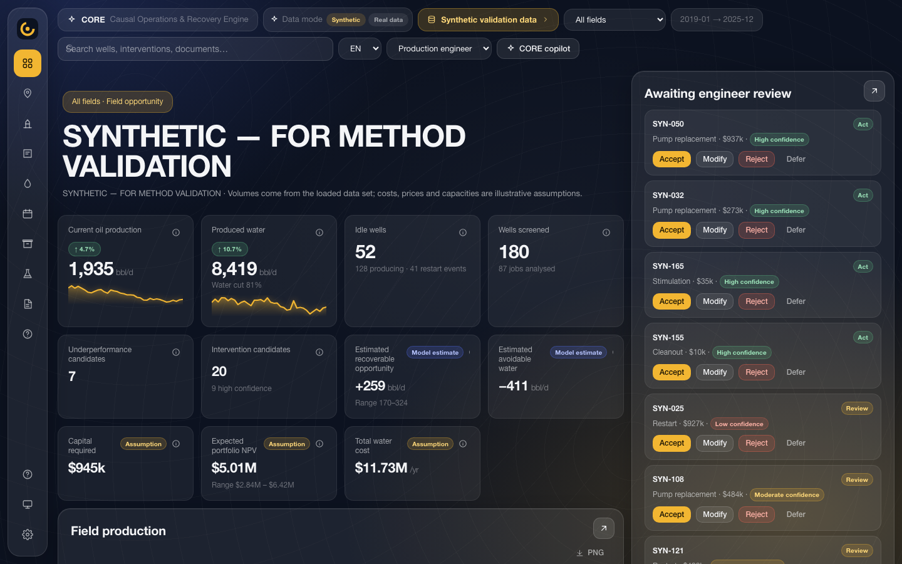
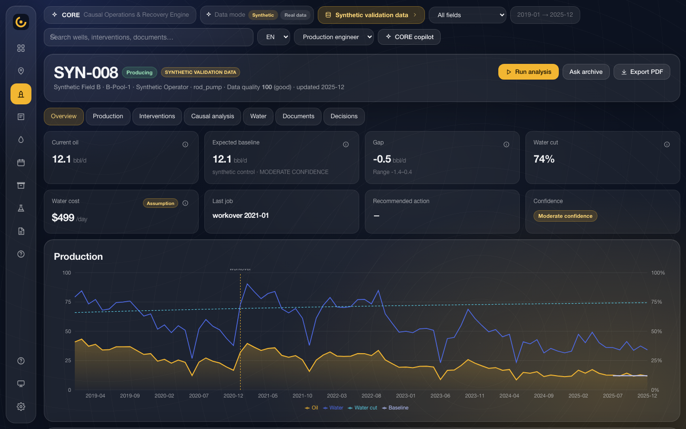
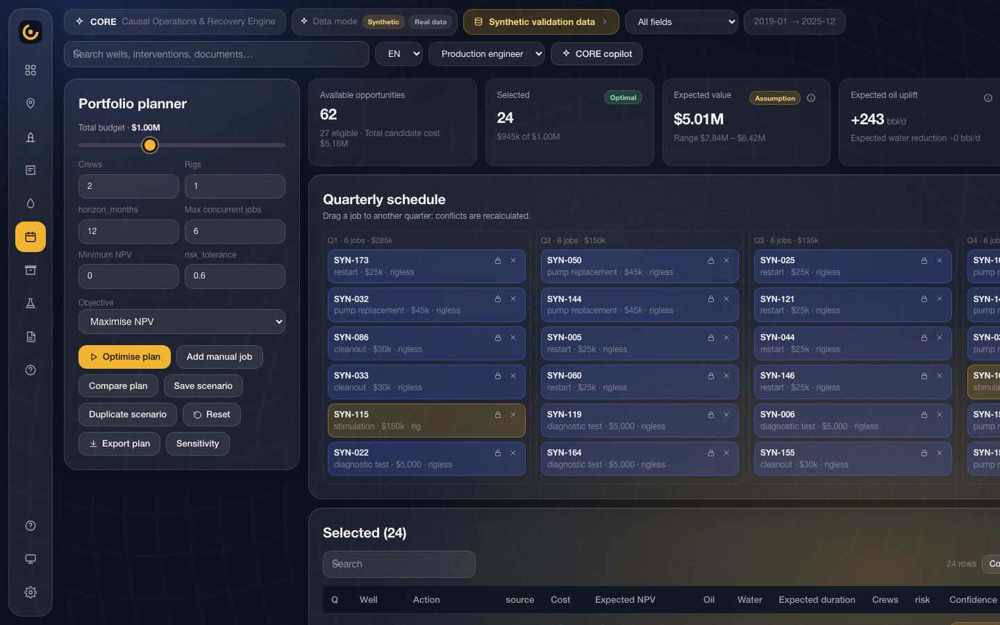
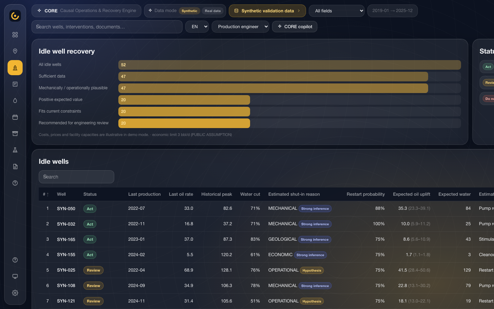
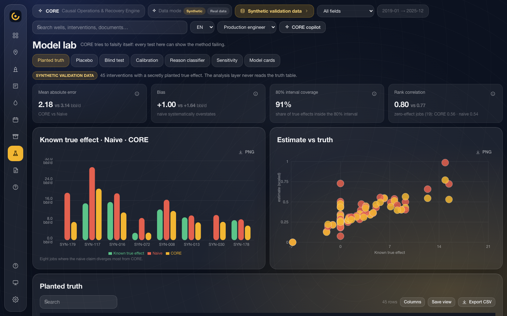
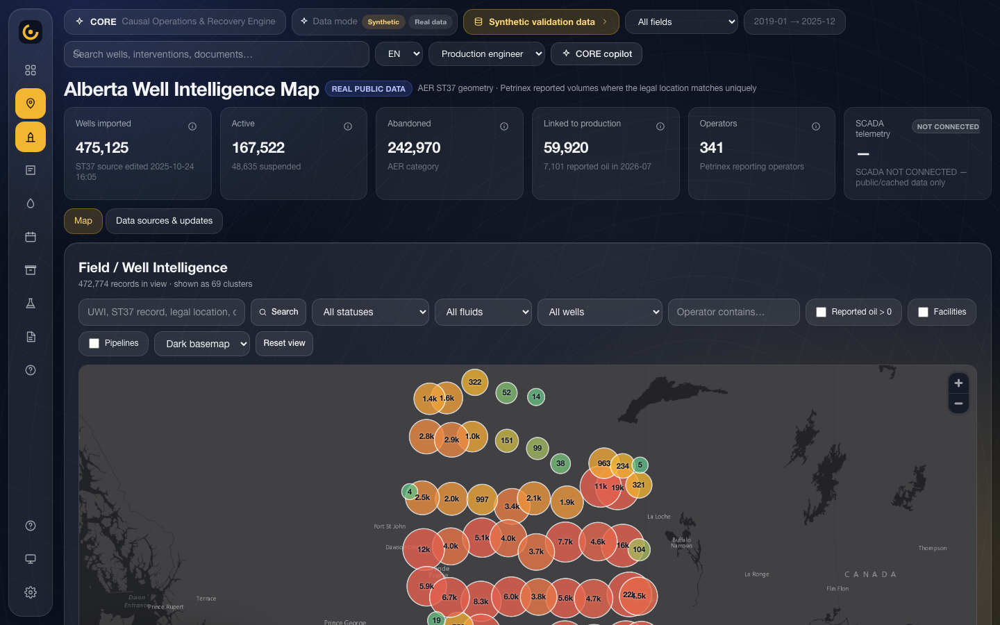
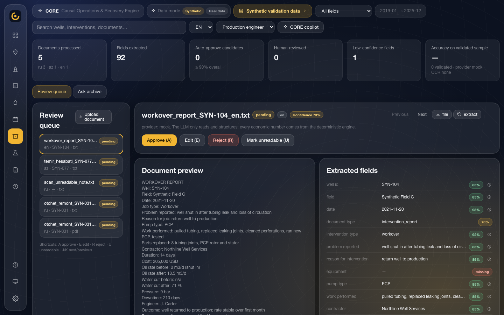
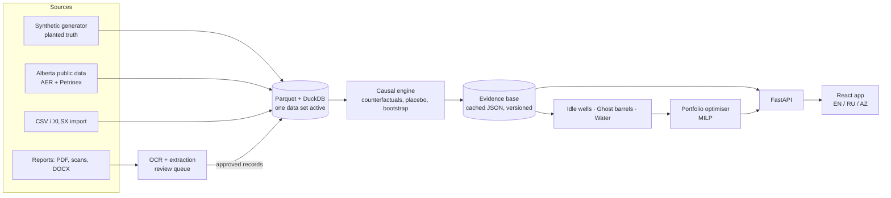

# CORE — Causal Operations & Recovery Engine

[](https://github.com/madmaxfv0/core-causal-operations-engine/actions/workflows/ci.yml)

CORE is a decision-support tool for oil-field production engineers. It estimates what past well interventions actually changed (not just what happened before and after), screens idle and underperforming wells, and builds an intervention programme that fits a budget, crew and rig constraints.

**Live demo:** <https://core-demo.fly.dev> (read-only public mode; the first visit after it has been idle takes about 40 seconds to wake)



## Problem and purpose

A well is usually worked over *because* it was deteriorating, and a whole field often recovers afterwards for reasons unrelated to the job: pressure support, price-driven optimisation, weather. A simple before/after comparison credits the job with both effects, so the jobs that looked best in the records are not reliably the ones worth repeating.

CORE builds a "no-intervention" counterfactual for each job from comparison wells or a decline curve, and reports **actual minus counterfactual** with an interval, a confidence label and the provenance of every input. The same evidence base then drives the idle-well screen, the underperformance screen, the water economics and the portfolio optimiser, so one set of numbers supports several decisions.

## Project status

**Proof of concept.** Built for SOCAR WIN 2026 as a working demonstration of the method.

- The bundled data set is **synthetic** and labelled as such everywhere in the UI. It was generated with a hidden, planted truth so the method can be scored.
- Real **public** data (Alberta Energy Regulator and Petrinex) can be downloaded with one script and is kept separate from the synthetic set.
- No operator data is included, and CORE has not been run on a real operator's field. The operator API connector is a contract only.
- It runs as a single process on one machine. There are no user accounts.

## Screenshots

All screenshots are from the running application, on the bundled synthetic data unless stated.

| | |
|---|---|
|  One well: production against its counterfactual baseline |  Portfolio optimiser: 24 jobs selected under a $1M budget |
|  Idle-well screen |  Model lab: validation against the planted truth |
|  Alberta map (real public data: AER ST37 and Petrinex) |  Archive: structured extraction from RU / AZ / EN reports |

More in [docs/screenshots](docs/screenshots).

## Main features

- **Causal effect of interventions** — synthetic control, matched wells, log difference-in-differences and decline-curve baselines, with automatic model selection, bootstrap intervals and placebo tests ([`backend/core/causal.py`](backend/core/causal.py)).
- **Idle-well screen** — ranks shut-in wells for restart, with a rule-based shut-in reason and analogue restarts as evidence ([`backend/core/idle.py`](backend/core/idle.py)).
- **Underperformance screen ("ghost barrels")** — producing wells running below their own counterfactual baseline ([`backend/core/ghost.py`](backend/core/ghost.py)).
- **Water economics** — turns water cut into a cost per barrel, including a capacity shadow cost when a facility is near its limit ([`backend/core/water.py`](backend/core/water.py)).
- **Portfolio optimiser** — a mixed-integer programme over candidate jobs with budget, concurrency, rig and crew limits, minimum NPV, risk tolerance and locked jobs ([`backend/core/portfolio.py`](backend/core/portfolio.py)).
- **Document archive** — OCR and structured extraction of workover reports in Russian, Azerbaijani and English into a strict schema with per-field confidence and a human review queue ([`backend/archive/`](backend/archive)).
- **Alberta public-data map** — about 475,000 real wells with facilities, pipelines and reported volumes, served through server-side clustering ([`backend/data/alberta.py`](backend/data/alberta.py)).
- **Provenance everywhere** — every economic input is tagged as a public assumption, operator-provided, calculated or a model estimate, and every causal run is cached with its data version, model version, parameters and seed.
- **Three languages** — the whole interface in English, Russian and Azerbaijani.

## Technology stack

| Technology | Role |
|---|---|
| Python 3.12, FastAPI, Uvicorn | One process serves the JSON API and the built single-page app. |
| pandas, NumPy, SciPy, scikit-learn | Counterfactual models, bootstrap, decline-curve fits. |
| PuLP (CBC solver) | The portfolio mixed-integer programme. |
| DuckDB, Parquet (PyArrow) | Storage and querying of well, production and map data. |
| pyproj | Coordinate handling for the Alberta well geometry. |
| pdfplumber, pytesseract, Pillow | Text extraction and OCR for uploaded documents. |
| ReportLab | PDF well reports. |
| React 18, TypeScript, Vite, Tailwind CSS 4 | The interface. |
| Recharts, MapLibre GL | Charts and the map (the map bundle is loaded only on `/map`). |
| pytest, jsdom, GitHub Actions | Backend tests, a route-level smoke test and CI. |

## Architecture



Module-by-module detail is in [docs/architecture.md](docs/architecture.md); endpoints are in [docs/api-reference.md](docs/api-reference.md).

## Quick start

Requirements: Python 3.11 or newer (3.12 tested). Node is only needed to rebuild the interface; a built copy is in `frontend/dist`.

```bash
scripts/start_demo.sh
```

That creates `.venv`, installs dependencies, prepares the demo data and starts the server. Open <http://localhost:8000>.

The same steps by hand:

```bash
python3 -m venv .venv && source .venv/bin/activate
```

```bash
pip install -r backend/requirements.txt
```

```bash
python scripts/init_demo.py
```

```bash
uvicorn backend.api.main:app --port 8000
```

`deploy/requirements.lock` pins the exact versions used for the tests and the deployed demo.

Optional pieces:

| To do this | Run |
|---|---|
| Work on the interface with hot reload (Node 20) | `cd frontend && npm install && npm run dev` then open <http://localhost:5173> |
| Install the real Alberta data behind `/map` (internet, about 200 MB, 8–10 minutes) | `python scripts/update_alberta_data.py --all` |
| Restore the demo to its starting state | `scripts/reset_demo.sh` |
| Use a hosted or local LLM for document extraction | see [docs/configuration.md](docs/configuration.md) |

No configuration is required. Every environment variable is optional and listed in [`.env.example`](.env.example).

## Example workflow

1. Open the app and press **Start demo** for a ten-step guided walkthrough, or follow the steps below yourself.
2. **Interventions** lists 87 analysed jobs. Open one: the naive before/after gain sits next to the causal estimate with its interval and confidence.
3. **Wells → SYN-008** shows production against the counterfactual baseline, the comparison wells used, and placebo results.
4. **Idle wells** ranks shut-in wells for restart, each with a suggested reason and the analogue restarts behind it.
5. **Portfolio** turns the candidates into a programme. Drag the budget slider: at $200k the optimiser selects 8 jobs, at $600k 21, at $1M 24, after which rig, crew and concurrency limits bind.
6. Accept, modify or reject a recommendation; the decision is logged with your reason.
7. **Model lab** shows how the method scored against the planted truth.

## Engineering decisions

| Decision | Why | Trade-off |
|---|---|---|
| Counterfactual estimates, not before/after | Removes field-wide recovery and pre-job decline from the credited effect. | Needs enough comparable wells; falls back to a decline curve, with lower confidence, when there are fewer than three. |
| Synthetic data with a planted truth | The true effect of each job is known, so error, bias and interval coverage can be measured. | Says nothing yet about performance on a real field. |
| Confidence is an evidence score, not a probability | It is gated on pre-period fit, donor count and placebo results, so a poor fit can never be labelled high. | It must not be read as a chance of success. |
| LLM only reads and structures documents | Every economic number is computed deterministically and is reproducible. The default provider is a rule-based extractor that works offline. | The offline extractor only handles report layouts it has patterns for. |
| Evidence base precomputed and cached | Pages load from cached JSON; each run records its data version, model version, parameters and seed. | The first build takes a few minutes and must be rebuilt when data or settings change. |
| One FastAPI process serving the built app | The demo runs offline from one command, with no Node at runtime. | No server-side rendering; no horizontal scaling. |
| Public-demo guard | On a public link, the endpoints that reset, rebuild or ingest shared data return 403. | It is a switch, not an authorisation system. |
| Source units kept as reported | Volumes stay in m³ / e3m³ with barrel conversions alongside, so nothing is silently converted. | Two sets of columns. |

Background for the data choices is in [docs/real-dataset-choice.md](docs/real-dataset-choice.md) and [docs/data-sources.md](docs/data-sources.md).

## Testing and evaluation

```bash
pytest backend/tests -q
```

100 tests: unit conversions and water-cut rules, restart detection, causal recovery on planted effects, placebo behaviour, portfolio constraints, API contracts, data-context isolation, document paths, and the Alberta ingestion and map API. On a fresh clone 77 run and 23 are skipped because they need the downloaded Alberta data; with that data installed all 100 pass.

```bash
cd frontend && npm ci && npm run build
```

```bash
npm install --no-save jsdom@24 && node smoke.mjs
```

The smoke test renders 36 routes against a running API and fails on any console or window error. Set `SMOKE_BASE` if the API is not on port 8000. `python scripts/button_audit.py` lists every interactive control in the interface with its handler: 249 controls, none unwired ([docs/button-audit.md](docs/button-audit.md)).

### Validation on the bundled synthetic data

These figures come from the engine's own validation endpoints (`/api/validation/*`) on the bundled data set and can be reproduced from the Model lab page. They describe a synthetic test, not field performance.

| Test | Result |
|---|---|
| Planted truth, 45 interventions | Mean absolute error 2.18 bbl/d (CORE) against 3.14 (before/after); bias +1.00 against +1.64; rank correlation 0.80 against 0.77; 80 % intervals cover 91 % of true effects |
| Zero-effect jobs (19) | Mean estimated effect 0.56 bbl/d (CORE) and 0.54 (before/after) |
| Placebo wells (870 estimates) | Mean −0.04 bbl/d, standard deviation 4.20 |
| Blind test, cut-off 2024-01, 15 wells | Rank correlation 0.925 (CORE) against 0.853 (last rate), 0.649 (highest previous production) and −0.09 (lowest water cut) |
| Shut-in reason classifier (45 wells) | 0.91 accuracy against the planted reasons |

Caveats: blind-test *levels* are biased low, so use the score for ranking only; the comparators are simple transparent rules, not an engineer's plan; and the reason scores are heuristic, not calibrated probabilities.

Not tested: OCR on real scanned documents, the hosted LLM providers, and the SCADA gateway connector have no automated tests.

## Limitations and roadmap

**Not built, or limited today**

- No authentication or per-role permissions. The role switcher only changes the landing page.
- No waterflood or injector optimisation; water is handled as produced-water economics and shut-off scenarios.
- Prices, costs, royalties and facility capacities are illustrative public assumptions, editable in Settings and labelled wherever they appear. Corrosion and scale costs are marked "operator data required" and never priced.
- Connectors for Saskatchewan, North Dakota, Kansas and Volve are stubs that route to the CSV import. Only the Alberta adapter downloads data.
- Private telemetry has no public source. The SCADA panel reads "not connected" unless an operator gateway is configured; values are never simulated.
- The decision log records decisions, but outcomes are only filled in when later production is loaded.
- Russian and Azerbaijani OCR needs the matching Tesseract language packs.

**Next steps for a pilot**

1. Load three to five years of an operator's production and job history through the CSV import.
2. Replace the illustrative economics with operator values.
3. Rebuild the evidence base and repeat the placebo, calibration and blind tests on the operator's own restart history.
4. Track the pilot scorecard at `/api/pilot/scorecard`.

## Documentation

| Document | Contents |
|---|---|
| [docs/architecture.md](docs/architecture.md) | Modules, data flow, models, caching |
| [docs/api-reference.md](docs/api-reference.md) | Endpoints with example requests and responses |
| [docs/configuration.md](docs/configuration.md) | Environment variables, LLM providers, public-demo mode, deployment |
| [docs/data-sources.md](docs/data-sources.md) | Provenance of every data source |
| [docs/alberta-map.md](docs/alberta-map.md) | How the Alberta data is ingested, joined and served |
| [docs/real-dataset-choice.md](docs/real-dataset-choice.md) | Why Alberta Petrinex was chosen as the real public data set |
| [docs/scada-integration.md](docs/scada-integration.md) | The telemetry gateway contract |
| [docs/closed-loop-learning.md](docs/closed-loop-learning.md) | Recording intervention outcomes |
| [docs/data-qa-guide.md](docs/data-qa-guide.md) | Manual checks that real and synthetic data are never mixed |
| [docs/repository-cleanup.md](docs/repository-cleanup.md) | What changed when this repository was prepared |

## Authorship and acknowledgements

Author: **Fakhriyya Vazirova**.

Public data: Alberta Energy Regulator (ST37 well list, ST102 facility list, pipeline data) and Petrinex public volumetric data. The full downloads are fetched by the user at run time and are not stored here; a small processed Petrinex extract (under 1 MB, in `data/processed/alberta_petrinex`) is included so the real-data mode can be opened offline. Base map tiles are requested at run time from Esri and OpenStreetMap.

Open-source libraries are listed in [`backend/requirements.txt`](backend/requirements.txt) and [`frontend/package.json`](frontend/package.json).

CORE estimates, prioritises and presents evidence to support engineering decisions. It does not operate wells or replace engineering judgement.

No licence has been chosen for this repository.
