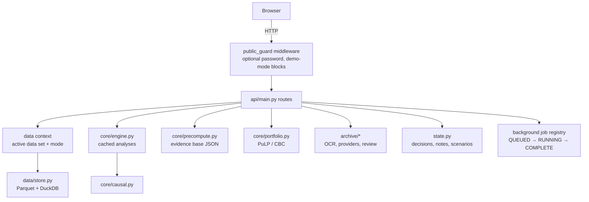

# Architecture

Derived from the source tree. For endpoints see [api-reference.md](api-reference.md); for settings see [configuration.md](configuration.md).

## Runtime shape

One Python process. FastAPI serves the JSON API under `/api/*` and the built React app from `frontend/dist` for every other path. There is no separate database server: data sets are Parquet files queried through DuckDB and pandas, and application state is JSON on disk.

## Backend modules

| Module | Responsibility |
|---|---|
| `backend/api/main.py` | All routes, the background job registry, single-page-app serving. Errors are returned as messages, never tracebacks. |
| `backend/api/public_guard.py` | Optional shared password and the public-demo block list. |
| `backend/config.py` | Paths, model version, default settings. Every default economic value carries a provenance tag. |
| `backend/state.py` | Decisions, notes, saved scenarios, donor overrides and plan edits, stored as JSON. |
| `backend/scada.py` | Optional HTTP telemetry gateway client. Disconnected unless configured. |
| `backend/core/causal.py` | Synthetic control (SLSQP), matched wells, log difference-in-differences, decline curve, automatic selection, bootstrap, placebo-in-time and placebo wells. |
| `backend/core/matching.py` | Which wells may serve as comparison wells, with ranked reasons for exclusion. |
| `backend/core/decline.py` | Arps decline-curve fitting. |
| `backend/core/restart.py` | Detects shut-ins and restarts from production history with configurable thresholds. |
| `backend/core/economics.py` | Netback, NPV, payback, water unit cost, capacity shadow cost. |
| `backend/core/memory.py` | Intervention memory: recorded jobs plus observed restarts, summarised by type. |
| `backend/core/idle.py` | Idle-well funnel, rule-based shut-in reason, analogue restarts, scenarios. |
| `backend/core/ghost.py` | Producing wells below their counterfactual baseline, with a graded explanation. |
| `backend/core/water.py` | Water economics, facility utilisation, shut-off scenarios. |
| `backend/core/portfolio.py` | The mixed-integer programme, objectives, baselines and sensitivity (tornado). |
| `backend/core/validation.py` | Planted-truth metrics, placebo summary, blind test, calibration, reason accuracy, model cards. |
| `backend/core/precompute.py` | Builds the evidence base and detects when it is stale. |
| `backend/core/engine.py` | Runs and caches individual causal analyses. |
| `backend/core/synthetic.py` | Generates the bundled synthetic field with its planted truth. |
| `backend/core/quality.py` | Data-quality scoring. |
| `backend/core/copilot.py` | Deterministic explanations of rankings; optional LLM rephrasing. |
| `backend/archive/ocr.py` | Text extraction (pdfplumber) and OCR (Tesseract). |
| `backend/archive/providers.py` | Extraction providers: rule-based `mock`, Anthropic, OpenAI, local OpenAI-compatible. |
| `backend/archive/schemas.py` | The strict extraction schema: each field has a value, a confidence and a source span. |
| `backend/archive/extraction.py` | Document registry, extraction pipeline, review queue. |
| `backend/data/store.py` | Reading and writing data sets; derived columns such as barrels and water cut. |
| `backend/data/context.py`, `mode.py` | Which data set is active and whether the app is in synthetic or real mode. |
| `backend/data/imports.py` | The CSV / XLSX import steps and the operator API contract. |
| `backend/data/petrinex.py`, `petrinex_cache.py` | Petrinex monthly volumetrics download, normalisation and per-well cache. |
| `backend/data/alberta.py` | AER source catalogue, normalisation of ST37 / ST102 / pipelines, viewport and cluster queries, join report. |
| `backend/data/arcgis.py` | Paginated, retrying, atomically cached reader for public ArcGIS feature services. |
| `backend/data/ats.py` | Alberta Township System identifiers: maps an AER surface location to a Petrinex well identifier. |

## Data layout

| Path | Contents | In git |
|---|---|---|
| `data/processed/synthetic/` | Bundled synthetic data set, including the planted truth | yes |
| `data/processed/alberta_petrinex/` | Processed 400-well Petrinex extract | yes |
| `data/processed/cache/<data set>/` | Evidence base: aggregated results as JSON | yes |
| `data/processed/cache/run_*.json` | One file per causal run | no |
| `data/demo/` | Sample documents and demo state | yes |
| `data/raw/`, `data/uploads/` | Downloaded Petrinex archives, user uploads | no |
| `data/alberta/raw/`, `data/alberta/cache/` | Downloaded AER files and validated Parquet caches | no |

## Synthetic data set

180 wells in three fields over 84 months (2019-01 to 2025-12), generated by `backend/core/synthetic.py`. Interventions are planted with a hidden true effect, including jobs with zero and negative effect, together with planted shut-in reasons, field-wide shocks and data-quality faults. The truth tables are stored beside the data and are only read by the validation code.

## Counterfactual models

| Model | Chosen automatically when | Notes |
|---|---|---|
| Synthetic control | At least 5 eligible comparison wells and pre-period R² of at least 0.6 | Non-negative weights summing to one, fitted on the pre-period |
| Matched wells | At least 3 comparison wells | Inverse-distance weighted mean of the nearest |
| Difference-in-differences | On request | Log difference against the comparison mean |
| Decline curve | Fewer than 3 comparison wells | Arps fit on the pre-period, flagged when the fit is poor |

Intervals come from a block bootstrap with AR(1) residual noise, widened by the spread of placebo-well effects. Confidence (`HIGH`, `MODERATE`, `LOW`, `INSUFFICIENT EVIDENCE`) scores evidence quality from pre-period fit, donor count, placebo results and missing data.

Default parameters (`backend/config.py`): 12-month pre and post windows, up to 25 comparison wells, 60 bootstrap samples, 12 placebo wells, seed 7.

## Portfolio optimiser

A mixed-integer programme solved with CBC through PuLP. Each candidate job is a binary decision per quarter. Constraints: total budget, crews, rigs, maximum concurrent jobs, minimum NPV per job, risk tolerance, safety blocks and user-locked jobs. Default settings: $1,000,000 budget, 2 crews, 1 rig, 12-month horizon, 6 concurrent jobs.

## Caching and reproducibility

- Each causal run is stored as `run_<hash>.json`, keyed by data-set version, model version, parameters and seed, and listed at `/runs`.
- The evidence base is rebuilt when the data set or settings change (`precompute.stale()`).
- Long operations (rebuilds, Alberta downloads) run as background jobs polled through `/api/jobs/{job_id}`.

## Frontend

React 18 with React Router, in `frontend/src`. `pages/` holds one file per area (Overview, Field, Interventions, Portfolio, Ops, Lab, Map, Presentation, Guide, WellDetail); `components/` holds the shell, data-context bar, tables and the floating-layer system; `lib/` holds the API client, translations and provenance popovers. The MapLibre bundle is code-split and loaded only on `/map`.
